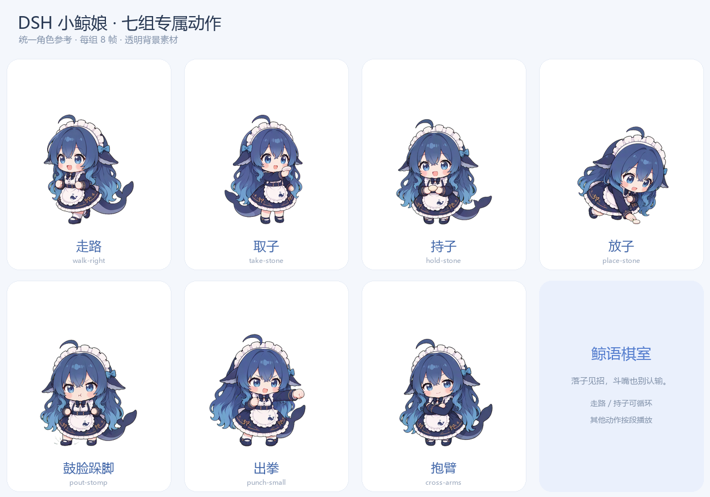

# DSH Chess Room

Play Gomoku with DeepSeekHarness and a playful whale-maid companion.

[中文说明](README.md) · [Artwork terms](ASSET-LICENSE.md) · [Third-party notices](THIRD_PARTY_NOTICES.md)



Features include 15×15 freestyle Gomoku, a dedicated DSH model session with validated move candidates and a local-engine fallback, short speech bubbles, character movement and stone placement, three playful avatar punches after a player win, undo, local persistence and replay. Optional workspace/conversation selection reads bounded committed text to preserve conversational style; the original conversation is not modified or resumed.

The Host commits and persists game moves. Character animations present confirmed events and cannot change the board or match result.

## Install

Download the ZIP from [Releases](https://github.com/zhang942579/DSH-Chess-Room/releases). Extract it to a permanent directory. Using DSH Plugin Manager's local-bundle installation/link capability, install `dsh-chess-room` first, then `dsh-chess-room-live-client`. Open DSH Chess Room from the sidebar.

The first public prerelease includes Host 1.2.0 and Client 1.2.1. The package-declared DSH range is `>=0.2.1-rc.3 <0.3.0`; offline validation and runtime limits are documented in [verification.md](docs/verification.md).

## Develop

Node.js 24.9+ on the 24.x line and pnpm 11 are required.

```sh
pnpm install --frozen-lockfile
pnpm build
pnpm test
pnpm check
pnpm package
```

Development tests run offline without a personal DSH session or paid AI requests. Optional image validation uses Pillow and numpy from `requirements-dev.txt`. DSH provides React and model configuration; no image-generation API key is required to install or play.

The current game is Gomoku. Go, international chess, Chinese chess and shogi are future work.

Project-authored code is MIT licensed. Character images and embedded image data have separate distribution terms. The development manifest validator retains dsh-pet's Apache-2.0 license.
