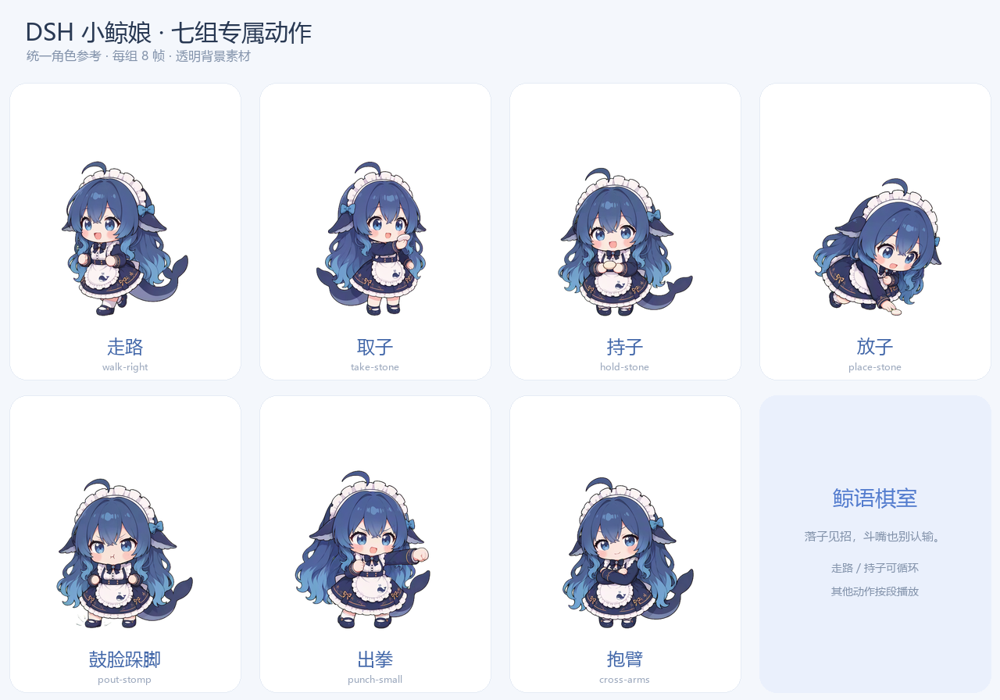

# DSH Chess Room

陪 DeepSeekHarness 下五子棋，和棋盘边的小鲸娘斗嘴。

[English](README.en.md) · [安装说明](docs/installation.md) · [开发指南](docs/development.md) · [素材授权](ASSET-LICENSE.md)



上图是七组动作素材的静态预览；运行时会结合棋盘坐标、道具移交和事件节拍播放。GIF 预览见[动作播放](docs/images/actions-preview.gif)。

## 已实现

- **自由五子棋**：15 × 15、黑先，无禁手，连续五子或更多获胜。
- **DSH 对弈**：独立棋室模型会话提交候选，Host 校验合法性并保存；模型不可用或返回非法候选时回退到本地引擎。
- **鲸娘演出**：棋盘边走动、取子、持子、放子，短气泡跟随角色；玩家规则获胜后鼓脸跺脚、靠近头像、轻锤三下、抱臂邀请再战。
- **短句斗嘴**：普通对话目标 15–40 字、最多 60 字；约每两个完整回合主动短评一次，支持安静模式。
- **玩家身份**：读取 DSH 当前登录账号的头像/昵称；字段缺失时使用默认展示。
- **保存和复盘**：悔棋、新局、认输、提示，恢复当前局并查看最近棋局。
- **熟悉的交流风格**：可选择工作区和对话，只读有界的已提交文字历史；可以取消选择。

棋局由 Host 的规则与持久状态决定。动画只展示已经确认的棋步；跳过、取消、切换页面、悔棋和新局会取消旧演出并同步棋盘。

## 安装

首个公开版本由 **Host 1.2.0 + Client 1.2.1** 两个 DSH bundle 组成；Release 标签使用 `v1.2.1-open.1`。

1. 下载 [Releases](https://github.com/zhang942579/DSH-Chess-Room/releases) 中的 `DSH-Chess-Room-v1.2.1-open.1.zip` 并解压到固定目录。
2. 使用 DSH Plugin Manager 安装/链接解压后的 `dsh-chess-room`（Host）。
3. 再安装/链接 `dsh-chess-room-live-client`（Client）。
4. 在 DSH 侧栏打开「DSH 棋室」。模型沿用 DSH 的配置，无须提供图片生成 API 密钥。

详细步骤与更新/卸载说明见[安装说明](docs/installation.md)。仓库源码也可以安装，但开发时先执行下方的依赖安装与构建。

兼容范围由包清单声明为 DSH `>=0.2.1-rc.3 <0.3.0`；开发工具要求 Node.js 24.9+（24.x）和 pnpm 11。公开预发布的测试范围与局限见[验证记录](docs/verification.md)。

## 开发

```sh
git clone https://github.com/zhang942579/DSH-Chess-Room.git
cd DSH-Chess-Room
pnpm install --frozen-lockfile
pnpm build
pnpm test
pnpm check
pnpm package
```

`pnpm package` 输出 `dist/DSH-Chess-Room/`，包含两个可安装的插件目录和文件散列清单。离线测试不会发送真实棋步、使用个人 DSH 会话或调用付费模型/图片 API。

## 数据与上下文

棋局与选定的上下文来源由 DSH 本地存储保存。选择对话后，其有界历史文本可能随棋室模型请求交给 DSH 配置的模型服务，以延续称呼和交流风格；请只选择希望用于对弈的来源。插件不续跑、改写原对话，也不在仓库或安装包中携带真实账号、头像、聊天和存档。

## 路线图

目前只支持五子棋。后续计划扩展围棋、国际象棋、中国象棋、将棋，并逐步改进专用动作的流畅度、左右朝向和单包安装体验。

## 许可与致谢

自有代码采用 [MIT](LICENSE)。鲸娘及 AI 衍生动作经维护者确认可随本项目公开分发，适用[独立素材说明](ASSET-LICENSE.md)，不自动采用代码 MIT 许可。

参考 [zhu1090093659/dsh-pet](https://github.com/zhu1090093659/dsh-pet) 的 frames2d 清单格式；开发验证器保留其 Apache-2.0 许可、原始源码和变更记录。未复制上游宠物图片。详细来源见 [THIRD_PARTY_NOTICES.md](THIRD_PARTY_NOTICES.md)。
